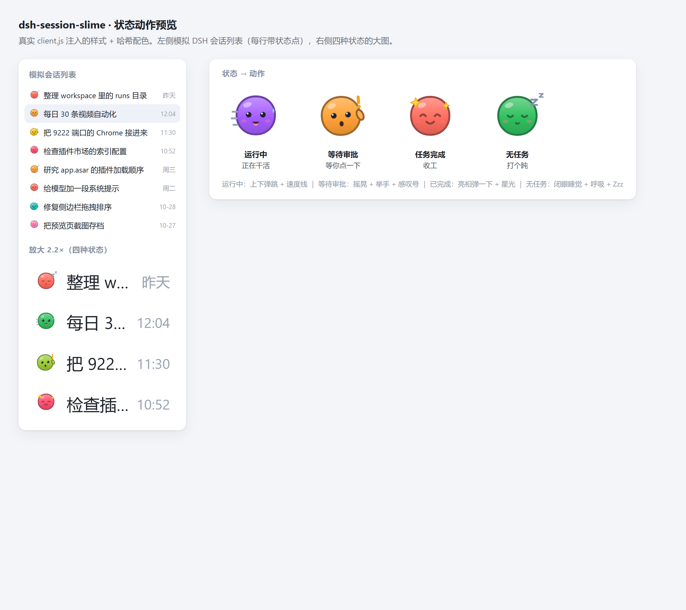
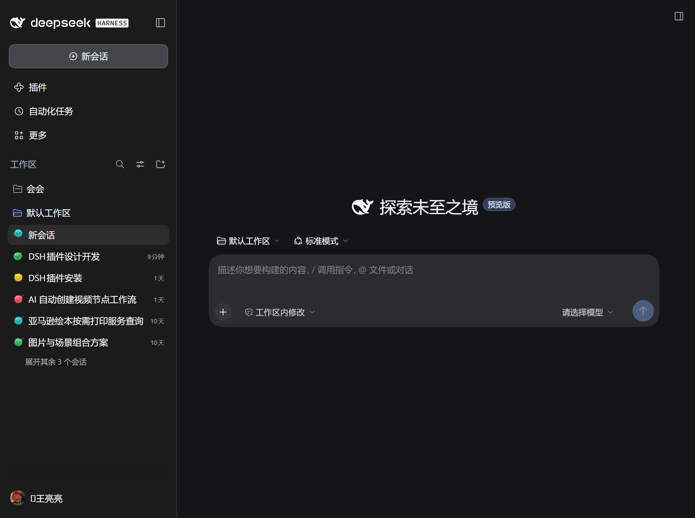

# dsh-session-slime

给 DSH 侧边栏里的每个对话加一枚**不同颜色的史莱姆**，并让它按这个对话的实时状态做动作：

| 状态 | 史莱姆的动作 | 触发条件（DSH 自己判定） |
| --- | --- | --- |
| 运行中 | 上下弹跳 + 速度线 + 汗滴 | 会话正在跑（含子代理在跑） |
| 等待审批 | 左右摇晃 + 举手 + 橙色感叹号 | 等审批 / 等计划确认 / 等你回答问题 |
| 任务完成 | 亮相弹一下 + 星光，随后缓慢浮动 | 本轮任务已完成 |
| 无任务 | 闭眼睡觉 + 呼吸起伏 + Zzz | 空闲 |





## 实现

- 纯客户端插件（host 侧只声明包名，让宿主把 `client.js` 派发给浏览器）。
- 状态不用猜：侧边栏每行自带状态点，DOM 上是 `[data-state]`：
  - `data-state="ongoing"` → 运行中；
  - `data-state="warning"` → 等待审批（审批 / 计划确认 / 提问）；
  - `data-state="done"` → 已完成；
  - 行内没有 `[data-state]` → 空闲。
  用 `MutationObserver` 监听 `data-state` 变化，状态一变就换表情和动画。
- 图标画在 `[data-row-key^="session:"]::before` 上：伪元素不是 React 节点，行重渲染、拖拽、hover 都不会把它碰掉。
- 图标**取代**原来的前导状态槽（含那个状态点），所以无论有没有状态点，标题都从同一个 x 开始；状态信息由史莱姆本身承担。
  如果那个槽里有别的插件渲染的内容，则保留该槽，不覆盖别人的东西。
- 每行颜色来自会话 id 的 FNV-1a 哈希（12 色调色板），同一对话颜色稳定；`(hash >>> 9) % 3` 选睡觉表情之一，避免整列完全一样。
- 动画只在 `prefers-reduced-motion: no-preference` 下启用；系统开了"减少动态效果"就只剩静态表情。

## 安装

仓库地址：<https://github.com/mousewangyongliang/dsh-session-slime>

```
# 从本地目录装
dsh plugin --profile desktop add <this directory>

# 或直接从 GitHub 装（需要能访问 github.com）
dsh plugin --profile desktop add github:mousewangyongliang/dsh-session-slime
```

它会把包挂进 `~/.dsh/profiles/desktop/node_modules`，并把 `dsh-session-slime` 追加进
`package.json` 的 `dsh.profile.bundles`（因为包自带 `dsh.bundle.patch`，无需手改配置）。

安装后需要**完全退出并重新打开** DSH 桌面版（客户端插件在启动时组合启动图）。

卸载：

```
dsh plugin --profile desktop remove dsh-session-slime
```

## 已验证

- 2026-11-02：用 `dsh web`（web 载体）+ 无头 Chrome/CDP 实测：
  - 启动图里包含 `dsh-session-slime/client.js`，侧边栏 6 行全部绘制出史莱姆，页面零 JS 异常；
  - 往真实行里注入三种状态点后，对应行立刻切到 `running` / `approval` / `done`，
    `::before` 的 `animation-name` 分别为 `dsh-slime-bob` / `dsh-slime-wiggle` / `dsh-slime-pop, dsh-slime-float`，空闲行为 `dsh-slime-breathe`；
  - 截图见 `preview/real-states.png`（以及 4× 放大版 `preview/real-states-zoom.png`）。
- 桌面载体与 web 载体走同一套 client-modules 派发（`fetchBundle()`），因此桌面版重启后同样生效。

## 调试

- `preview/preview.html`：桩 `window.__ModuleLoader__` 后加载真实 `client.js`，含模拟列表（四种状态点）、2.2× 放大区、四状态大图。
- `preview/debug-preview.mjs`：CDP 打开预览页，检查注入的样式、行状态、图标变量、控制台异常。
- `preview/real-states.mjs`：CDP 打开带 token 的 `dsh web` 地址，关掉欢迎弹窗、注入状态点、断言状态与动画、截图。
- 控制台里 `window.__DSH_SLIME_PREVIEW__` 暴露 `svgFor` / `iconUri` / `cssIcon` / `stateOf` / `hash` / `PALETTE` / `STATES`。
